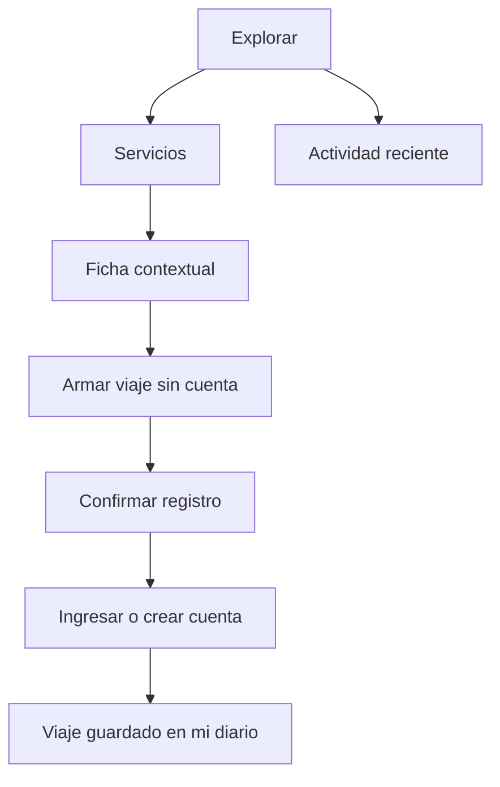

# Definición del MVP

## Tesis

Letterbondi es un archivo social organizado por servicios de transporte. El usuario encuentra una línea por número, ciudad o provincia; desde esa ficha registra el viaje y el registro pasa a formar parte de su diario y de la actividad pública.

El principio de organización es **object-first**: líneas y trenes son los objetos estables; registrar, puntuar y reseñar son acciones contextuales.

## Trabajos principales

1. Encontrar rápidamente el servicio en el que viajé.
2. Registrar fecha, puntuación y una reseña opcional.
3. Volver a mi diario o leer la actividad de la comunidad.

## Incluido en la beta

- Catálogo buscable por modo, ciudad y provincia.
- Ficha compacta con recorrido, promedio, cantidad de registros y fuente.
- Exploración y armado del viaje sin registro previo.
- Alta o ingreso contextual al confirmar, conservando el borrador hasta autenticar.
- Cuenta con email, contraseña y sesión persistente segura.
- Registro de viaje con fecha, puntuación de 1 a 5 y texto opcional.
- Actividad pública y diario de la sesión actual; la API ya expone perfiles por usuario.
- API JSON documentada con OpenAPI.
- Diseño responsive y accesible.
- SQLite persistente, Docker y tests de frontend/backend.

## Siguiente, después de validar uso

- Páginas indexables por línea y usuario.
- Importador CSV idempotente para ampliar provincias.
- Reportar datos incorrectos o solicitar una línea faltante.
- Moderación, bloqueo y borrado de contenido.
- Favoritos y listas curadas.

## Fuera de alcance

- PWA, notificaciones y funcionamiento offline.
- Compartir capturas generadas.
- Tiempo real, GPS, horarios y precios.
- Likes, comentarios, badges y gamificación.
- Ratings sobre conductores o unidades identificables.
- Datos o reseñas ficticias presentadas como actividad real.

## Navegación

Navegación global: `Explorar`, `Mi diario` —sólo con sesión— y la acción primaria `Registrar viaje`.

## Vocabulario

- **Servicio**: término paraguas para línea de colectivo, tren, subte o trolebús.
- **Viaje**: una experiencia fechada del usuario en un servicio.
- **Registro**: la entrada pública resultante.
- **Diario**: historial cronológico de una persona.
- **Fuente**: organismo o dataset del que proviene la ficha.

## Dirección visual

Industrial-editorial, sobria y compacta. Se usa Archivo como única familia tipográfica; carbón, hueso y ámbar forman la base. El único gesto distintivo es la chapa rectangular con el color y denominación de cada servicio. No se utilizan gradientes, glows, tarjetas flotantes, emojis ni iconografía ornamental.

## Gobernanza de datos

Todo servicio debe incluir ciudad, provincia, URL de fuente y fecha de actualización si está disponible. Una ampliación nacional debe hacerse mediante importadores revisables; cantidad de filas no equivale a cobertura completa. La interfaz siempre comunica “beta” y la cobertura real disponible.
